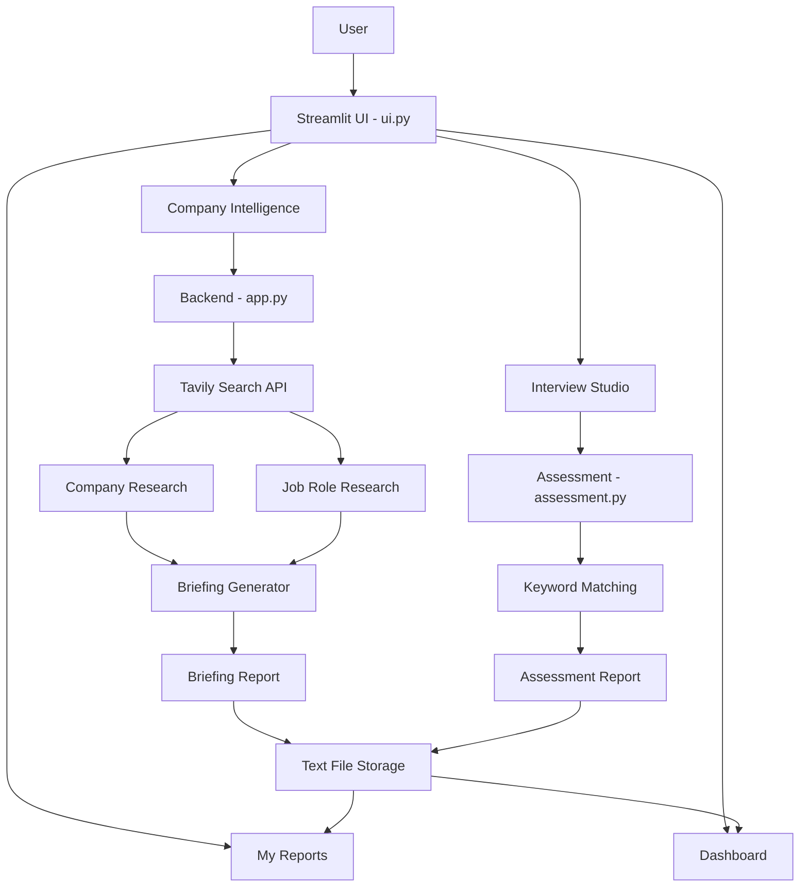

# EmployAI — System Architecture

## System Workflow

## Technology Architecture

| Component | Technology | Purpose |
|---|---|---|
| Frontend | Streamlit | User interface |
| Backend | Python | Application logic |
| Research | Tavily API | Web research |
| Assessment | Python | Keyword-based evaluation |
| Configuration | python-dotenv | Secure API key loading |
| Storage | Text files | Save generated reports |

## Application Flow

1. User enters company and job-role details.
2. Streamlit sends the information to the Python backend.
3. Tavily searches for relevant company and job-role information.
4. EmployAI generates a pre-meeting briefing.
5. Interview Studio generates questions and evaluates submitted answers.
6. Reports are saved as text files.
7. Users can access reports through the Dashboard and My Reports.

## Future Scope

- Semantic AI-based interview evaluation.
- More detailed company intelligence.
- Personalized interview preparation.
- PDF report generation.
- Additional research sources.
